<div align="center">

# Lunar Landing Site Navigator

**Compare lunar south pole landing sites and dates by where the Sun and Earth sit against the real local horizon.**

NASA Space Apps Challenge 2026 &nbsp;|&nbsp; Team **LunarOps**

[](https://13-52-97-105.sslip.io)
[](https://github.com/fury-05/nasa-lunar-landing-navigator-2026/actions/workflows/ci.yml)
[](https://github.com/fury-05/nasa-lunar-landing-navigator-2026/releases)
[](LICENSE)
[](https://github.com/fury-05/nasa-lunar-landing-navigator-2026/commits/main)

[](https://github.com/fury-05/nasa-lunar-landing-navigator-2026/issues)
[](https://github.com/fury-05/nasa-lunar-landing-navigator-2026/issues?q=is%3Aissue+is%3Aclosed)
[](https://github.com/fury-05/nasa-lunar-landing-navigator-2026/pulls)
[](https://github.com/fury-05/nasa-lunar-landing-navigator-2026/pulls?q=is%3Apr+is%3Aclosed)
[](https://github.com/fury-05/nasa-lunar-landing-navigator-2026/graphs/contributors)
[](https://github.com/fury-05/nasa-lunar-landing-navigator-2026)


**[Open the live site](https://13-52-97-105.sslip.io)** &nbsp;|&nbsp; **[How to use it, with pictures](docs/HOW-TO-USE.md)** &nbsp;|&nbsp; **[Architecture and formulas](#architecture-and-how-the-numbers-are-calculated)**

</div>

> **Planning tool, not for flight operations.** Every result shows its sources, assumptions and uncertainty. Nothing here replaces mission-grade analysis.

## Start here

| I want to... | Go to |
|---|---|
| Try it now | [13-52-97-105.sslip.io](https://13-52-97-105.sslip.io), press **Open the Command Centre** |
| Learn the screens step by step, with marked screenshots | [docs/HOW-TO-USE.md](docs/HOW-TO-USE.md) |
| See how the numbers are calculated | [Architecture and how the numbers are calculated](#architecture-and-how-the-numbers-are-calculated) |
| Read every control and term | [docs/USER_GUIDE.md](docs/USER_GUIDE.md) |
| Check the validation results | [docs/validation/REPORT.md](docs/validation/REPORT.md) |
| See sources and credits | [Data sources and attribution](#data-sources-and-attribution) |

## See the light and shadow move

The animation is real. Each frame below is a capture of the live site at a different time on the time slider (Shackleton rim, `pgda-site04`, one frame every 10 hours from 2026-12-12 06:00 UTC). The sky view shows the Sun (amber) and Earth (blue) against the real horizon. The 2D map and the 3D view are lit by the real Sun direction for that time, and the dark patches are true cast shadows. On the live site the same views run smoothly with the **Play** button.

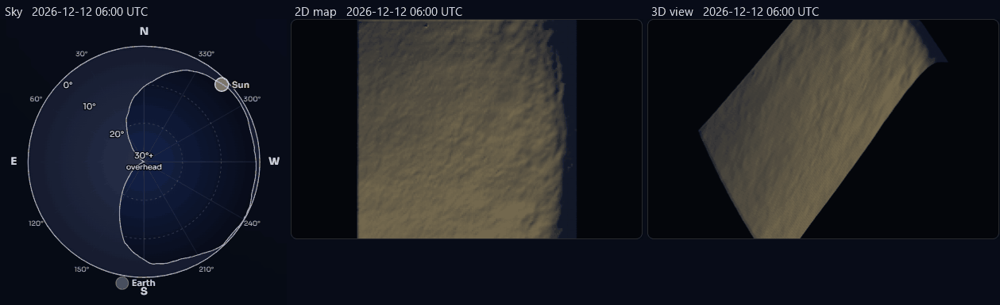

<p align="center"><a href="docs/HOW-TO-USE.md">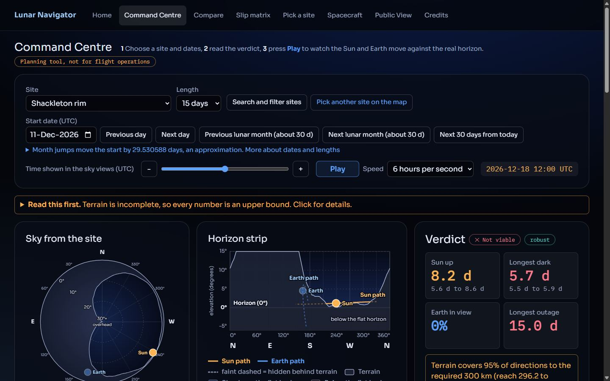</a></p>

## The challenge

Challenge: **Lunar Landing Site Navigator** (NASA Space Apps Challenge 2026).

Landing near the lunar south pole is hard because the Sun skims the horizon, terrain throws long shadows, and Earth can drop below the horizon, which cuts direct-to-Earth communication. The question this tool answers: *if we land here, in this window, how much sunlight do we get and when can we talk to Earth?* The challenge-to-feature mapping with requirement ids is in [docs/01-challenge-map.md](docs/01-challenge-map.md).

## What works today

Checked against the code and the live site on 2026-11-15. Routes in the app: `/`, `/command`, `/compare`, `/slip`, `/sites/pick`, `/public`, `/spacecraft`, `/credits`.

| Feature | What it really does |
|---|---|
| **Command Centre** (`/command`) | Pick a site, a start date (2026-12-01 to 2029-11-01, UTC) and a length (3, 8, 15 or 30 days). Shows a verdict with an uncertainty range, sunlight and Earth link metrics, a polar sky view with the Sun and Earth against the terrain skyline, a horizon strip, local terrain (a shaded 2D map and an oblique pseudo-3D canvas view), four timeline strips, sunset and Earthset countdowns, and a time scrubber with a Play button and a speed control that moves every view together. The link state lives in the URL, so a link reproduces a view. |
| **Compare** (`/compare`) and **Slip matrix** (`/slip`) | Compare two to four sites side by side, and see how the result changes when the landing date slips by a few days. Same engine, same upper-bound labels. |
| **Mission needs** | Editable thresholds (minimum sunlight share, longest dark spell, minimum Earth link share, optional longest outage). The defaults are placeholders and are labelled as such until mission criteria are approved. |
| **Honesty states** | When terrain data does not reach as far as the required distance, the verdict is shown as an amber "Upper bound, terrain incomplete" instead of a green result, with the covered share and reach. A "Not viable" result stays as is, because missing terrain can only make it worse. |
| **Site picker** (`/sites/pick`) | Moon Trek polar map (OpenLayers, south polar stereographic) with site markers; click a marker to open it. Custom coordinates (south of 60 S, east-positive longitude) start a background job that builds the Sun and Earth series, with progress shown. |
| **QuickMap link** | "Open in QuickMap" on each site opens the public LROC QuickMap south polar view at the site and chosen time, for manual cross-checking. |
| **Public View** (`/public`) | A guided story in plain language with a Simple or Detailed toggle, a glossary, a live slip example from the same engine, and links to Canadian Space Agency pages with attribution. |
| **Spacecraft Dashboard** (`/spacecraft`) | Compares a site's longest dark spell and longest Earth outage with lander assumptions. **The lander values (1000 Wh battery, 20 percent reserve, 10 W load, 48 h autonomy) are made-up placeholders**, labelled `pending-source` on screen. It is a flat energy comparison, not a battery simulation. |
| **Credits** (`/credits`) | Source list read from `GET /api/v1/attribution`, including which usage terms are still unconfirmed. |
| **API** | Read-only JSON API under `/api/v1` (sites, skyline, assess, timeline, state, compare, slip-matrix, custom site jobs with SSE progress, terrain tile, QuickMap links, attribution). Reference page at `/api/v1/docs`; contract in [packages/contracts/openapi.json](packages/contracts/openapi.json). |

Curated sites available on the live server: 10 tile-centre points from the PGDA LOLA south pole products (Site01, Site04, Site06, Site07, Site11, Site20, Site23, Haworth, Shoemaker, DM2), precomputed from 2026-12-01 to 2029-12-01 at 10 minute steps. The wider catalogue in [data/sites.json](data/sites.json) has 36 records (6 Apollo, 3 CLPS, 27 PGDA tile centres); only sites with a terrain tile are precomputed. The PGDA points are derived tile centres, not landing sites. A few custom sites built during testing also appear in the live list.

## What is NOT done or not validated

* **Terrain is still incomplete everywhere.** Since 2026-11-15 the ten curated sites are computed with three tiers (5 m site tile, 5 m 87S to 90S mosaic, 20 m LDEM; [ADR-0007](docs/DECISIONS/ADR-0007-far-terrain-tiers.md)) and the shortest ray reaches 146 to 296 km while the check asks for 300 km. No site reaches 300 km in every direction (share of directions that do: 0.455 to 0.949), so every verdict is still labelled an upper bound. Terrain beyond the data is not bounded (`pending-source`). The numbers are in [docs/validation/REPORT.md](docs/validation/REPORT.md) section 6. Custom points built by the picker use the same tiers where data exists.
* **Validation is partial.** Measured: Sun direction at six Apollo landing sites (five within 0.35 degrees of NASA's printed value, Apollo 16 off by 2.86 degrees, cause unknown), one Horizons set time within 30 seconds, an illumination cross-check against PGDA product 69 on 9 points, and a golden regression file; see [docs/validation/REPORT.md](docs/validation/REPORT.md). Not yet done by a person: height, slope and lit or shadowed comparisons against QuickMap ([docs/validation/quickmap-checks.md](docs/validation/quickmap-checks.md)). The skyline and frame error figures are assumptions where the report says so. Planning grade only.
* **Viability thresholds are placeholders** (approval A8 in [todo/APPROVALS.md](todo/APPROVALS.md)). "Viable", "Marginal" and "Not viable" do not mean mission requirements.
* **Usage terms:** read on 2026-11-15 and recorded in [docs/ATTRIBUTION.md](docs/ATTRIBUTION.md) for Horizons, the PGDA LOLA products, NASA media guidelines, the Canadian Space Agency, the NSSDC Apollo table and the CLPS page. Moon Trek and QuickMap show no terms text to a text reader and stay `pending-source` until a person reads them (issue #16). A human confirmation of the recorded readings is still welcome.
* Not built or not met: the lunar-day and lunar-night date presets, draped Trek imagery on the 3D terrain, a 60 frames per second 3D view (measured about 20 fps in headless Chromium, a canvas painter and not WebGL), any thermal or charging model for the lander (the Spacecraft Dashboard uses placeholder lander values and marks thermal as not assessed). Moved to [ROADMAP.md](ROADMAP.md) by [ADR-0008](docs/DECISIONS/ADR-0008-freeze-scope-cut.md): Moon globe, sky dome, objective presets, saved scenarios.
* Earth link means line of sight only. Antennas, DSN stations, radio power and refraction are not modelled. The Moon has no atmosphere, so none is applied.

## Architecture and how the numbers are calculated

A deterministic Python engine (no machine learning in any number) takes the Sun and Earth direction seen from a site from NASA JPL Horizons, casts rays over a NASA LOLA elevation model with lunar curvature to build the skyline (the real horizon), measures how much of each disc is above it, finds sunrise, sunset, Earthrise and Earthset, and repeats the whole calculation with the skyline moved up and down to give an uncertainty range. A FastAPI service serves the results and a React app draws them.

### The system

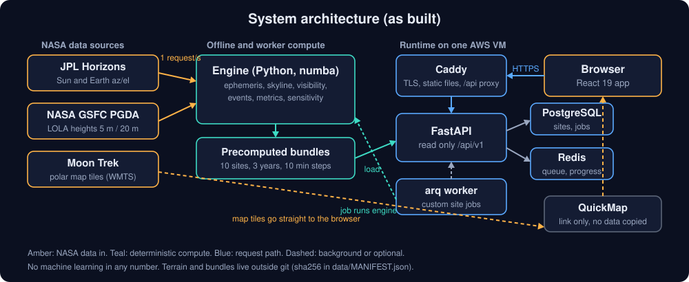

| Part | Where | Role |
|---|---|---|
| Web app | `apps/web` | React 19, TypeScript, Vite, Tailwind. OpenLayers for the polar map. The terrain views are drawn on a 2D canvas (no WebGL library), so they run on modest hardware |
| API | `services/api` | FastAPI, read only. Serves precomputed bundles, computes metrics for a requested window, runs custom-site jobs. Adds ETags, request ids, rate limits and RFC 7807 errors |
| Worker | `lunar_api.worker` | arq on Redis. Builds a custom site (Horizons plus terrain) with progress over server-sent events |
| Engine | `packages/engine` | Pure Python plus numba: ephemeris client, DEM sampler, skyline ray caster, disc visibility, events, metrics, sensitivity, compare and slip |
| Data | `data/`, VM disk | Site catalogue, manifests with sha256, attribution registry. Large rasters and bundles live outside git |
| Hosting | one AWS VM | Caddy (TLS, static files, `/api` proxy), systemd units, PostgreSQL 16, Redis 7 |

Full detail, caching, deploy and failure behaviour: [docs/ARCHITECTURE.md](docs/ARCHITECTURE.md).

### The calculation, step by step

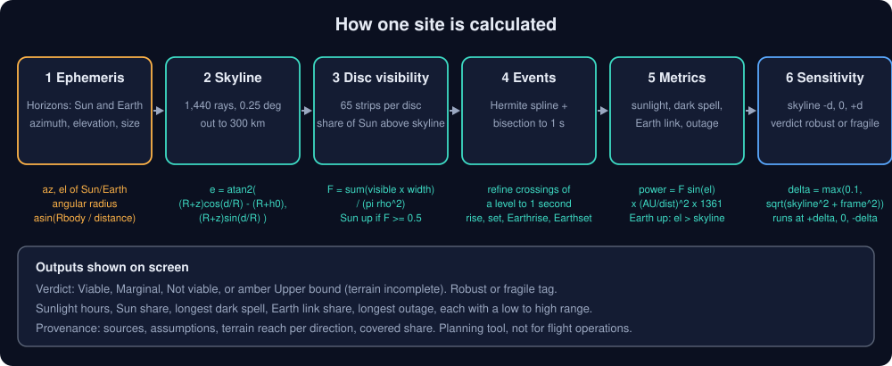

**1. Sun and Earth positions.** For each site the engine asks JPL Horizons for the apparent azimuth and elevation of the Sun and Earth, their distance and angular size, every 10 minutes (observer at `coord@301`, airless, Moon mean-Earth frame; [ADR-0004](docs/DECISIONS/ADR-0004-horizons-conventions.md)). Requests are polite (one per second), cached by sha256, and the API version is checked. Azimuth is measured clockwise from north. The angular radius of a disc is `rho = asin(body radius / distance)`.

**2. The skyline by ray casting.** From the site the engine walks outward along 1,440 directions (every 0.25 degrees). At each step it finds the ground point, reads its height from the elevation model and computes the angle at which that point is seen. The Moon is a sphere of radius `R = 1,737,400 m`, so the curvature drop is part of the formula, not a correction added afterwards:

```
theta = d / R
e     = atan2( (R + z) * cos(theta) - (R + h0),  (R + z) * sin(theta) )
skyline(azimuth) = max over d of e, never lower than the bare-sphere dip  -acos( R_site / (R_site + h_eye) )
```

`d` is the ground distance, `z` the height of the terrain sample above the reference sphere, `h0` the eye height above the sphere at the site. Sample points are placed by great-circle destination and then projected to south polar stereographic metres, so curvature is honoured at 16 km as at 300 km. Heights come from bilinear sampling. The kernel is compiled with numba and runs the azimuths in parallel.

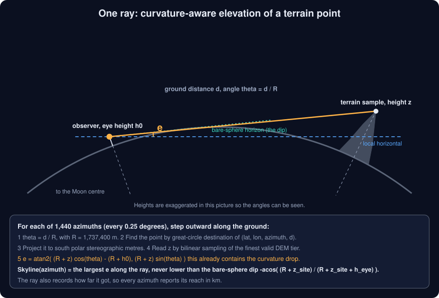

**3. Three terrain tiers.** At every step the engine uses the finest valid data: a 5 m site tile and a 5 m mosaic (87S to 90S) within 20 km, then the 20 m LDEM out to the required 300 km ([ADR-0007](docs/DECISIONS/ADR-0007-far-terrain-tiers.md)). A ray only ends when no tier has data. Each azimuth records how far it reached, plus the height error (ERR product) and effective resolution (EFFRES) at the sample that sets the horizon.

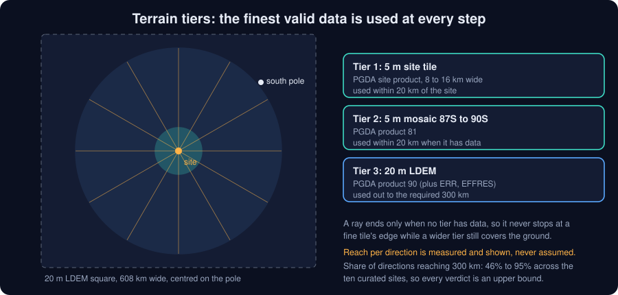

**4. How much of the Sun is visible.** The Sun and Earth are discs, not points. Each disc is cut into 65 vertical strips (placed by the substitution `x = rho sin t`, so a horizon through the centre gives exactly one half). For a strip at offset `x` with half height `s`, the visible part is `clamp((el + s) - max(skyline, el - s), 0, 2s)`, and the visible share `F` is the sum of strip areas over the disc area `pi * rho^2`. **The Sun counts as up when `F >= 0.5`**, which means the disc centre is on the skyline. **Earth link is available when the centre of Earth is above the skyline** (plus an optional mask angle). There is no refraction because the Moon has no atmosphere.

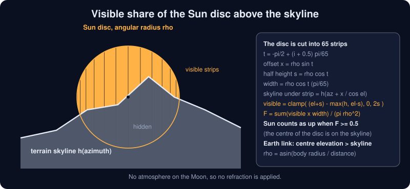

**5. Events and metrics.** The series are interpolated with a cubic Hermite spline (Catmull-Rom slopes) and level crossings are refined by bisection to one second. That gives sunrise, sunset, Earthrise and Earthset, then sunlight hours, Sun share of the window, longest dark spell, Earth link share and longest outage. Spans that touch the edge of the window are flagged as "at least this long". A relative power index is `F * max(sin el, 0) * 1361 W/m^2 * (1 AU / distance)^2`; it is an index on the array plane, not a lander power budget.

**6. Uncertainty and the verdict.** Every metric is computed three times with the skyline moved by `-delta`, `0` and `+delta`, where `delta = max(0.1 deg, sqrt(dem_error^2 + frame_error^2))`. The DEM error comes from the ERR product where it was measured; the Moon frame error is an assumed 0.03 degrees. The verdict (Viable, Marginal, Not viable) compares the metrics with the mission needs, and is tagged **robust** only if all three runs agree and **fragile** otherwise.

**7. Honesty about missing terrain.** If the terrain does not reach 300 km in every direction, the missing relief can only raise the true horizon, so every result is an upper bound. The API then returns `upper_bound_terrain_incomplete` with the share of directions that reached 300 km and the reach range. A "Not viable" result stays conclusive. The size of the unseen relief is `pending-source`, so it is never guessed.

### How the light and shadow views work

The terrain views receive the real height grid around the site from the API. For the time on the slider the page takes the Sun direction (azimuth and elevation). For every cell it computes the surface normal from the four neighbours and a Lambert term `max(0, n . sun)`. It then marches from the cell toward the Sun and marks the cell as shadowed if any cell on the way is higher than the line of sight to the Sun. Cells without height data are drawn grey, never as shadow. The 2D view paints that grid as a map; the 3D view rotates and tilts the same grid and paints the quads from far to near. Moving the slider or pressing Play redraws both, so the shadows move with the Sun. See [How to use it, step 5](docs/HOW-TO-USE.md#step-5-watch-light-and-shadow-on-the-terrain-it-is-real).

### Accuracy, in numbers

* Sun direction at six Apollo landing sites: five within 0.35 degrees of NASA's printed value, Apollo 16 off by 2.86 degrees (cause unknown).
* Terrain reaches the full 300 km in 46% to 95% of directions across the ten curated sites, so no verdict is conclusive yet.
* The Earth link is line of sight only; antennas, DSN stations and radio power are not modelled.

Every measured number: [docs/validation/REPORT.md](docs/validation/REPORT.md).

Stack: Python 3.12, FastAPI, SQLAlchemy and Alembic on PostgreSQL, Redis with arq, numpy and numba, rasterio and pyproj; React 19, TypeScript, Vite, Tailwind, OpenLayers and proj4; Caddy on one AWS VM. Tests: pytest and hypothesis, Vitest, Playwright with axe accessibility, keyboard and 375 px overflow checks, a CI workflow, and a deploy script that rolls back when the health check fails.

## Data sources and attribution

We use the four official Space Apps resources, plus NASA public data documented in an architecture decision record when the four do not offer what is needed. Rules: [docs/02-resources-and-attribution.md](docs/02-resources-and-attribution.md). Registry: [docs/ATTRIBUTION.md](docs/ATTRIBUTION.md) (machine readable: [data/attribution.json](data/attribution.json)). Notices: [NOTICE](NOTICE).

| Source (id) | Use in this project |
|---|---|
| [JPL Horizons](https://ssd.jpl.nasa.gov/horizons/) (`horizons`) | Sun and Earth azimuth and elevation from each site, event cross-checks |
| [Moon Trek](https://trek.nasa.gov/moon/) (`trek-moon`) | Polar map imagery through WMTS tiles. Not used for heights: Trek documents no raw elevation access ([ADR-0002](docs/DECISIONS/ADR-0002-trek-access.md)) |
| [LROC QuickMap](https://quickmap.lroc.im-ldi.com/) (`quickmap`) | Manual validation and "Open in QuickMap" links. No scraping |
| [CSA Moon exploration](https://www.asc-csa.gc.ca/eng/astronomy/moon-exploration/) (`csa-moon`) | Paraphrased blurbs and links in the Public View |
| [NASA GSFC PGDA, LOLA south pole topography](https://pgda.gsfc.nasa.gov/products/78) (`lola-dem`) | Terrain heights for the skyline (last resort source, [ADR-0003](docs/DECISIONS/ADR-0003-dem-source.md), [ADR-0007](docs/DECISIONS/ADR-0007-far-terrain-tiers.md)). Barker et al., 2021, Planetary and Space Science 203, 105119 |
| NASA NSSDCA Apollo table (`nssdc-apollo`), NASA CLPS deliveries (`nasa-clps`) | Site coordinates in the catalogue |

Third-party software licences: [docs/THIRD_PARTY_LICENSES.md](docs/THIRD_PARTY_LICENSES.md), generated by `python scripts/gen_licenses.py`.

## Screenshots

| | |
|---|---|
| [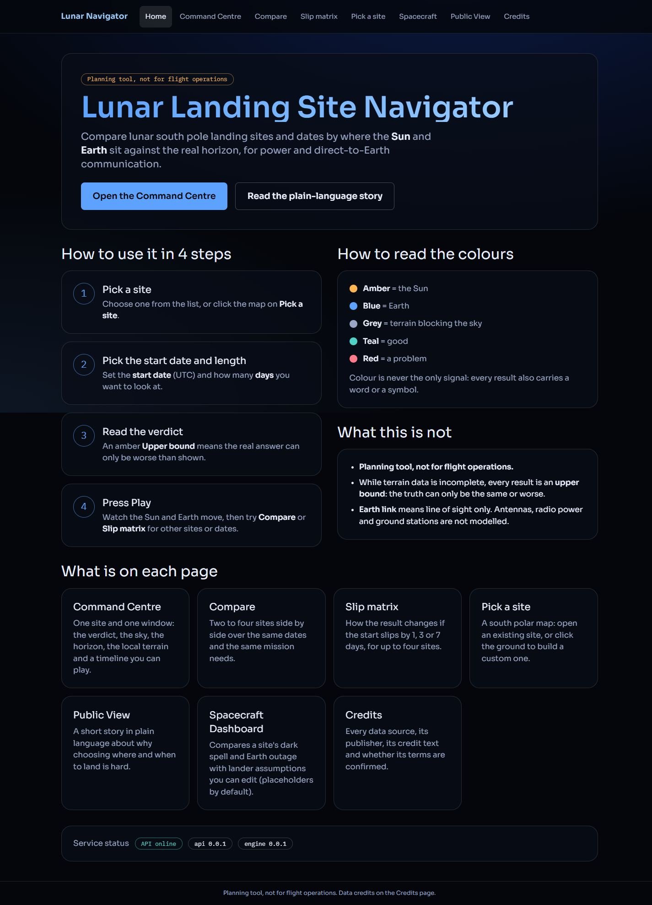](docs/HOW-TO-USE.md) **Home**: four steps, colour key, the 300 km explanation | [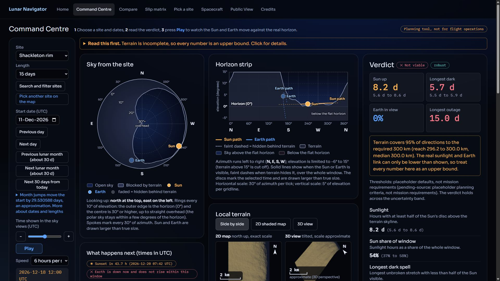](docs/HOW-TO-USE.md) **Command Centre** on a wide screen |
| [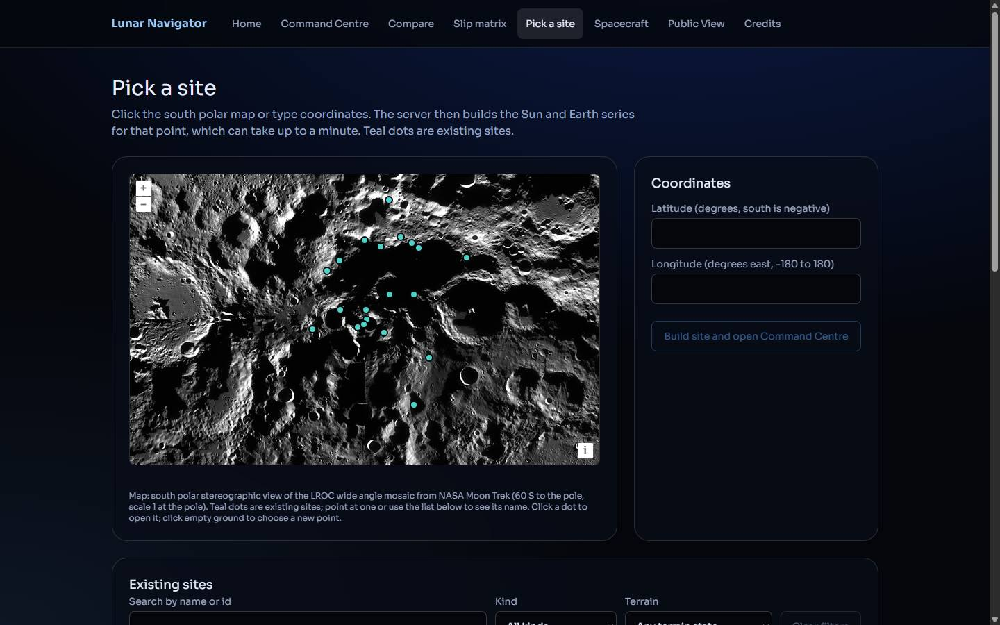](docs/HOW-TO-USE.md#step-7-pick-a-custom-site) **Site picker**: NASA Moon Trek polar map | [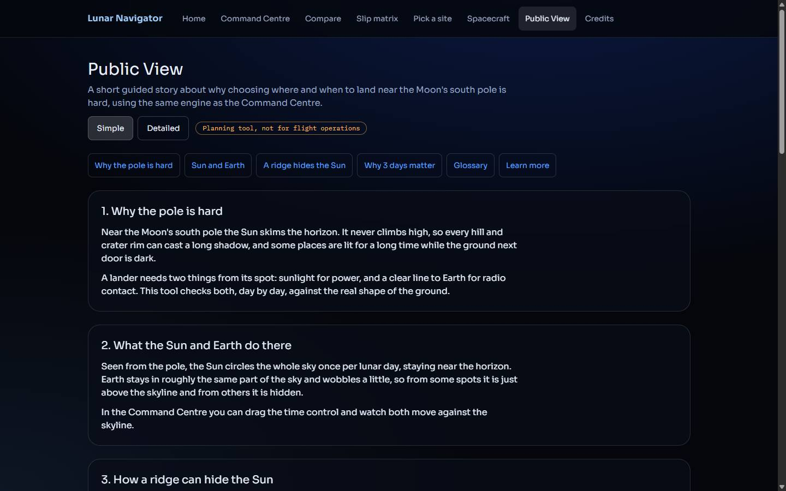](docs/demo-assets/README.md) **Public View**: the story for non-experts |

All screenshots: [docs/demo-assets/README.md](docs/demo-assets/README.md). They show upper bounds (terrain incomplete), not verified landing conditions.

## Run it locally

Needs Python 3.12 with [uv](https://docs.astral.sh/uv/), Node 24, and for the API a PostgreSQL and a Redis.

```
uv sync                      # Python workspace (engine and API)
npm ci                       # web app dependencies
uv run pytest                # Python tests
npm test --workspace apps/web   # web unit tests
npm run build --workspace apps/web
```

API: set `DATABASE_URL`, `REDIS_URL` and `LUNAR_DATA_DIR` (see `infra/env.example` and `.env.local.example`; never commit real values), then `uv run uvicorn lunar_api.main:app`. `/api/v1/ready` reports ready only when both database and Redis answer. Site routes read precomputed bundles from `$LUNAR_DATA_DIR/precompute`. Build them with `scripts/fetch_dem.py` (downloads PGDA tiles outside git, writes `data/MANIFEST.json`) and `scripts/precompute_sites.py` (calls Horizons politely, one request per second, cached). Web dev server: `npm run dev --workspace apps/web`, which proxies `/api` to `http://127.0.0.1:8000` or to `API_TARGET`.

The terrain and bundle data are large and live outside git.

## Honesty rules

* No invented coordinates, timestamps or numbers. Unsourced values are marked `pending-source`.
* A task counts as done only with a test, command output or deployed URL as evidence ([checklist/CHECKLIST.md](checklist/CHECKLIST.md)).
* Planning material (specifications and concept work) existed before the event. All implementation code was written after the start time recorded in [docs/START_LOG.md](docs/START_LOG.md). See [docs/START_PROOF.md](docs/START_PROOF.md) for what this does and does not prove.

## Team

| Person | GitHub | Main areas |
|---|---|---|
| Irfan S. Mulla | [@fury-05](https://github.com/fury-05) | Engine, data, API, infrastructure, deploy |
| Afreen Mulla | [@Stella-10](https://github.com/Stella-10) | Web app, design system, Command Centre, polar map, mission clock |
| Luz Aponte | [@nluz4105-ai](https://github.com/nluz4105-ai) | Public View content, Trek and QuickMap links, validation checks, attribution audit, demo assets |

Credit rules: all commits are pushed from one workstation (Irfan's session, GitHub login fury-05). The task owner is credited with a `Co-authored-by` trailer, and a collaborator is only named as commit author with their consent (`COMMIT_MODE=coauthor`, [docs/07-git-and-team-workflow.md](docs/07-git-and-team-workflow.md)). Teammates also contribute by reviewing pull requests, commenting on issues and performing the human validation steps.

## Use of AI tools

Claude (Anthropic) assists with code, tests and docs, under human direction and review. Commits carry a `SI-Assisted: Claude` trailer. There is no AI in any calculated number at run time. Details: [docs/SI_USAGE.md](docs/SI_USAGE.md).

## Repository layout

```
apps/web/            React + TypeScript web app (Command Centre, picker, Public View, Spacecraft, Credits)
services/api/        FastAPI service, jobs worker, database migrations
packages/engine/     lunar_engine: ephemeris, terrain, skyline, visibility, events, metrics, sensitivity
packages/contracts/  OpenAPI spec exported from the API code
data/                Site catalogue, manifests, attribution registry, CSA content
infra/               Caddy, systemd units, env template
scripts/             Automation (start gate, commits, checklist, deploy, data, audits, build_doc_images.py)
docs/                Specs, decisions, validation notes, HOW-TO-USE.md, architecture/ and howto/ pictures
todo/ checklist/     Task tables and the generated checklist
```

## Security

Public read-only app, no accounts. See [docs/validation/api-security-review.md](docs/validation/api-security-review.md) and [docs/validation/security-dependency-audit.md](docs/validation/security-dependency-audit.md). Secrets stay outside the repository.

## Contributing

Open source and welcome to feedback. Use Conventional Commits and no em dashes in code, docs or UI text (`scripts/lint-dashes.sh`). See [docs/07-git-and-team-workflow.md](docs/07-git-and-team-workflow.md).

## Licence

Licensed under the **Apache License 2.0** (see [LICENSE](LICENSE)).

Why: the [2026 Participant Terms and Conditions](https://www.spaceappschallenge.org/legal/) require original content to be freely available or licensed under an Open Source Initiative approved licence, and say NASA will distribute content under Apache 2.0 if none is specified. We choose Apache 2.0 explicitly, which keeps us compliant, adds a patent grant, and is compatible with permissive dependencies. Third-party data and software keep their own licences, listed in [NOTICE](NOTICE), [docs/ATTRIBUTION.md](docs/ATTRIBUTION.md) and [docs/THIRD_PARTY_LICENSES.md](docs/THIRD_PARTY_LICENSES.md). This project is not endorsed by NASA or the Canadian Space Agency.
