# How to use the Lunar Landing Site Navigator

A visual, step by step guide. Live app: **https://13-52-97-105.sslip.io**

> **Planning tool, not for flight operations.** Every number is an upper bound while terrain data is incomplete (see step 4).

The numbered gold circles in the pictures match the numbered lists under them. The screenshots were taken from the live site on 2026-11-15 and are not edited, only marked.

**The question the tool answers:** if a lander sets down at this spot during this window, how much of the time is the Sun above the real local horizon (power), and how much of the time is Earth above it (direct line of sight for communication)?

---

## Step 1. Start on the Home page

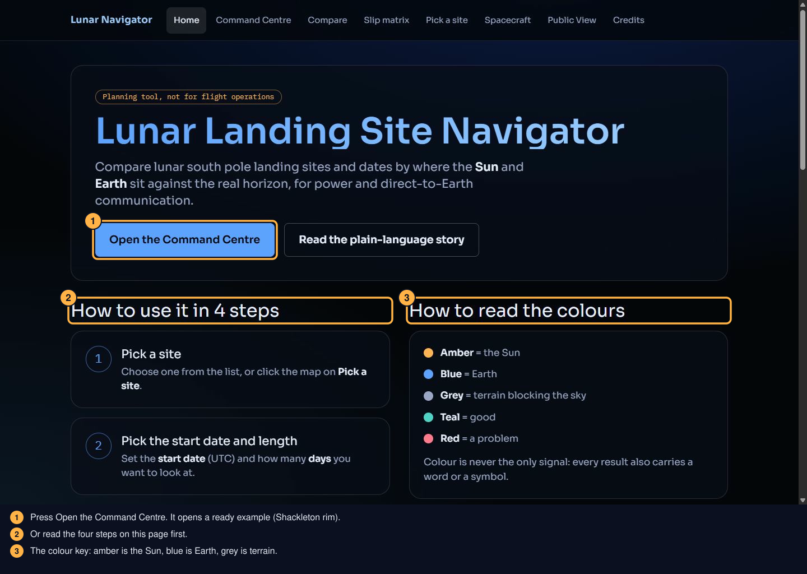

1. **Open the Command Centre** starts with a ready example (Shackleton rim).
2. The four steps and the "What does 300 km mean?" section explain the idea in plain words.
3. The colour key is used everywhere: amber is the Sun, blue is Earth, grey is terrain.

## Step 2. Choose a site and dates

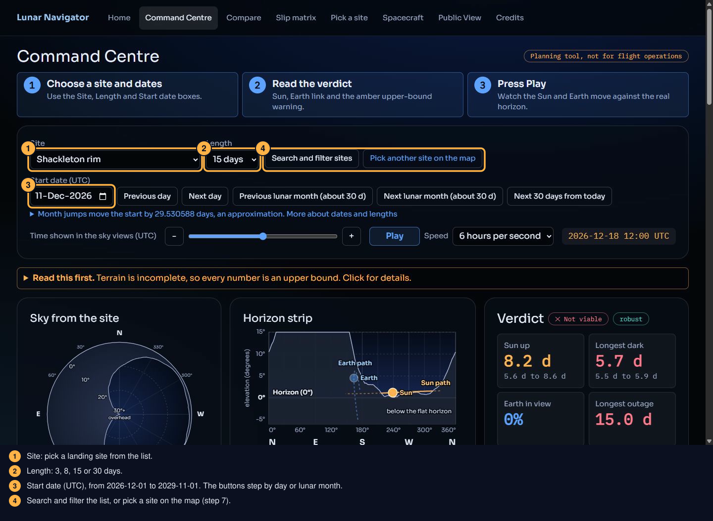

1. **Site**: the list holds ten curated south pole points, plus any custom sites people built.
2. **Length**: 3, 8, 15 or 30 days.
3. **Start date** in UTC, from 2026-12-01 to 2029-11-01. The buttons step by one day or about one lunar month (29.53 days).
4. **Search and filter** the list, or pick a point on the map (step 7).

The choices are stored in the web address. Copy the link and anyone sees the same view.

## Step 3. Press Play

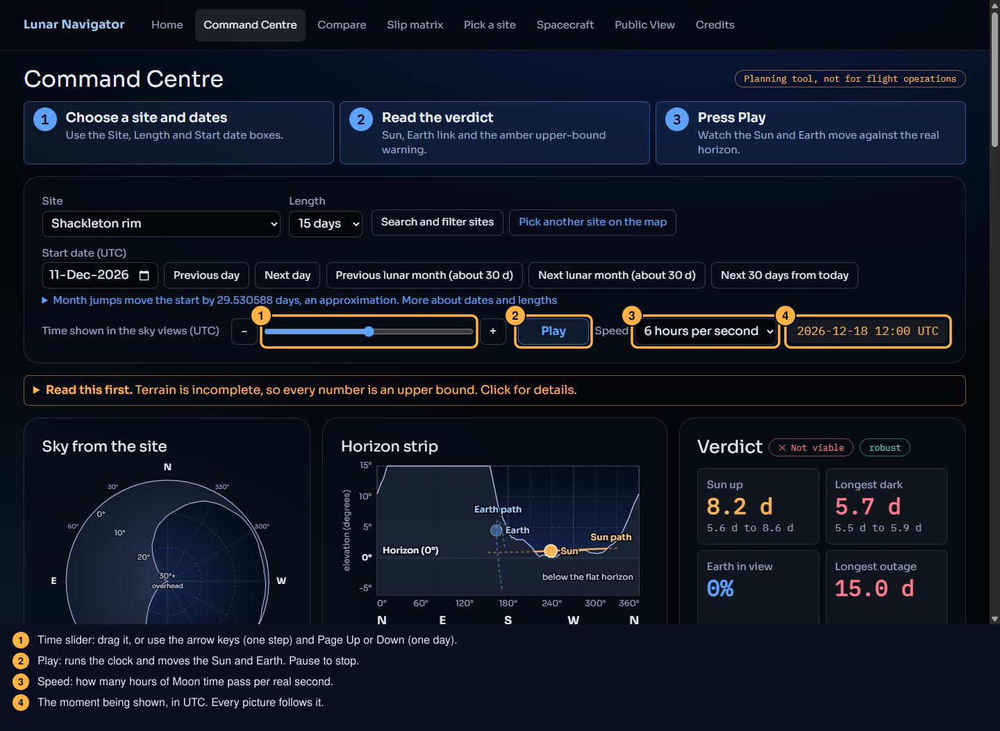

1. The **time slider** moves through the window. Use the arrow keys for one step and Page Up or Page Down for one day.
2. **Play** runs the clock. The Sun and Earth move across the sky.
3. **Speed** sets how much Moon time passes per real second.
4. The time shown is in UTC. Every picture on the page follows it.

## Step 4. Read the verdict

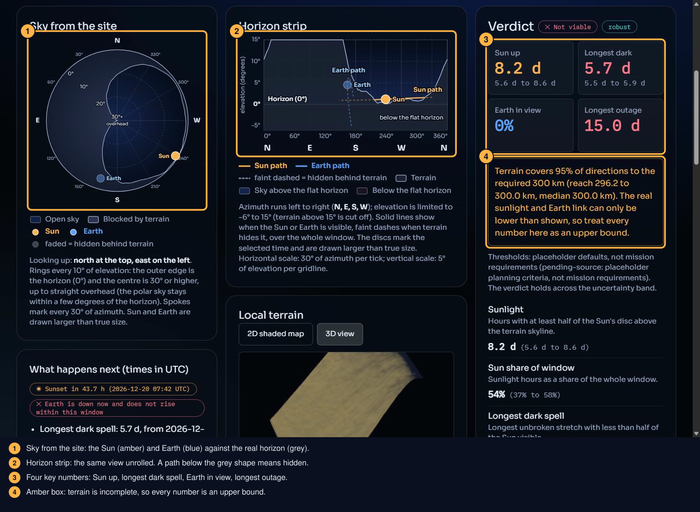

1. **Sky from the site** looks straight up. North is at the top. The grey shape is the real horizon made of hills and crater rims. The amber disc is the Sun, the blue disc is Earth.
2. **Horizon strip** is the same sky unrolled. Compass direction runs left to right and height above the flat horizon runs up. A track that dips under the grey shape means that body is hidden.
3. **Four key numbers**: hours of sunlight, longest dark spell, share of time Earth is in view, longest Earth outage. The grey range under each number is the uncertainty.
4. **The amber box** appears when the terrain data does not reach the full 300 km in every direction. The real sunlight and Earth link can then only be lower than shown, so read the result as an upper bound. A red "Not viable" stays "Not viable", because missing terrain can only make things worse.

The thresholds that decide Viable, Marginal and Not viable are placeholders. Change them under **Mission needs** further down the page.

## Step 5. Watch light and shadow on the terrain (it is real)

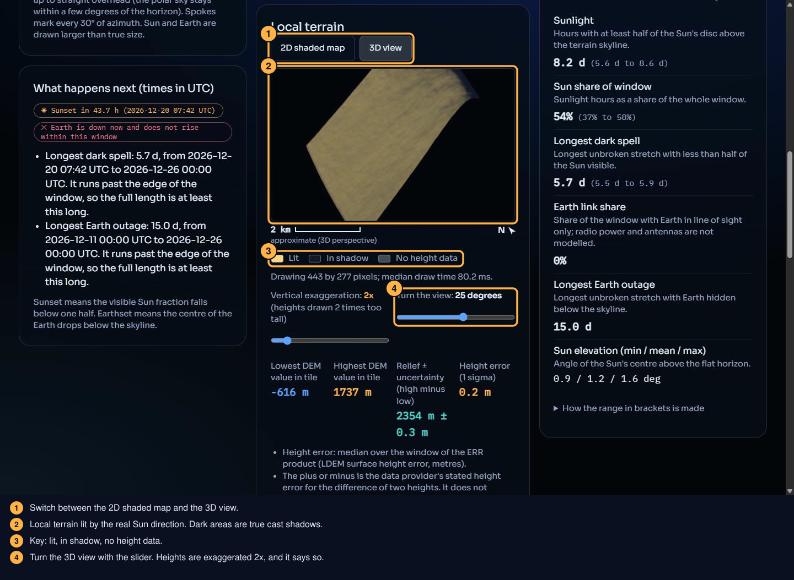

1. Switch between the **2D shaded map** and the **3D view**.
2. The ground is lit by the **real Sun direction** for the time on the slider. Dark patches are true cast shadows: the page marches from every cell toward the Sun and checks whether a higher cell blocks it.
3. The key: lit, in shadow, no height data (grey, never guessed).
4. Turn the 3D view with the slider. Heights are drawn 2 times too tall to make relief visible, and the page says so.

### The animation is real

These animations are not mock-ups. Each frame is a capture of the live site at a different time on the slider, for the Shackleton rim site (`pgda-site04`), every 10 hours from 2026-12-12 06:00 UTC. The frames are a sequence of captures, so the real page runs more smoothly. Watch the shadow edge on the right of the terrain move as the Sun circles the horizon.

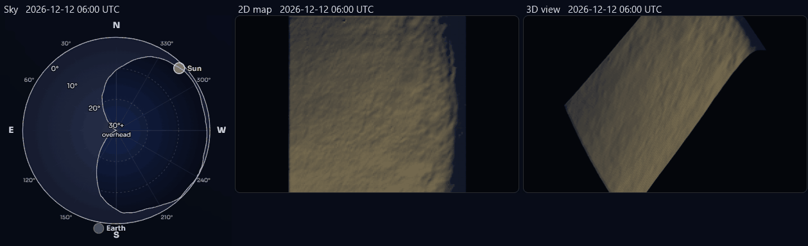

| Sky: Sun and Earth against the horizon | 2D map: light and shadow | 3D view: same Sun |
|---|---|---|
| 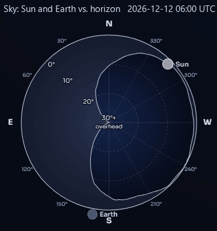 | 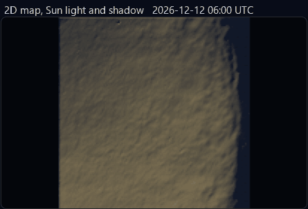 | 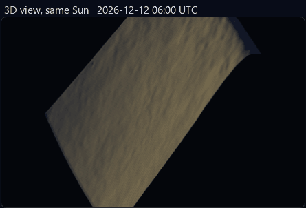 |

## Step 6. Timeline, site facts and export

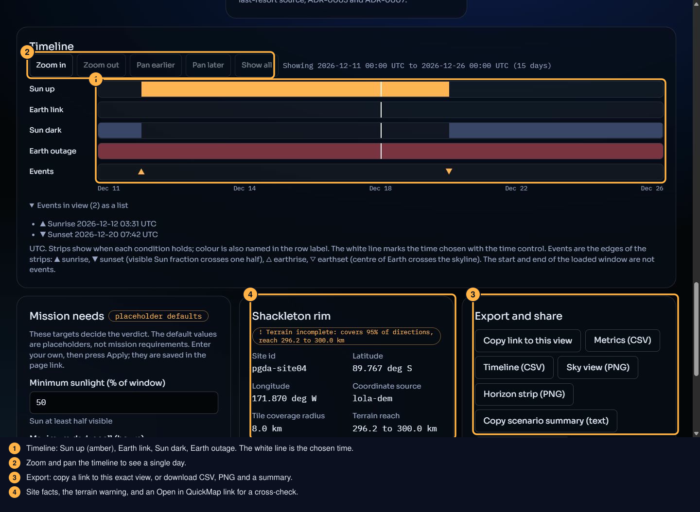

1. The **timeline** shows four strips: Sun up (amber), Earth link, Sun dark and Earth outage. The white line is the time on the slider. Triangles mark sunrise and sunset.
2. Zoom and pan to look at a single day.
3. **Export and share**: copy a link to this exact view, download metrics or the timeline as CSV, save the pictures as PNG, or copy a summary with sources and assumptions.
4. **Site facts** list the coordinates, where they came from, the terrain reach, and an **Open in QuickMap** link to cross-check against NASA's public viewer.

## Step 7. Pick a custom site

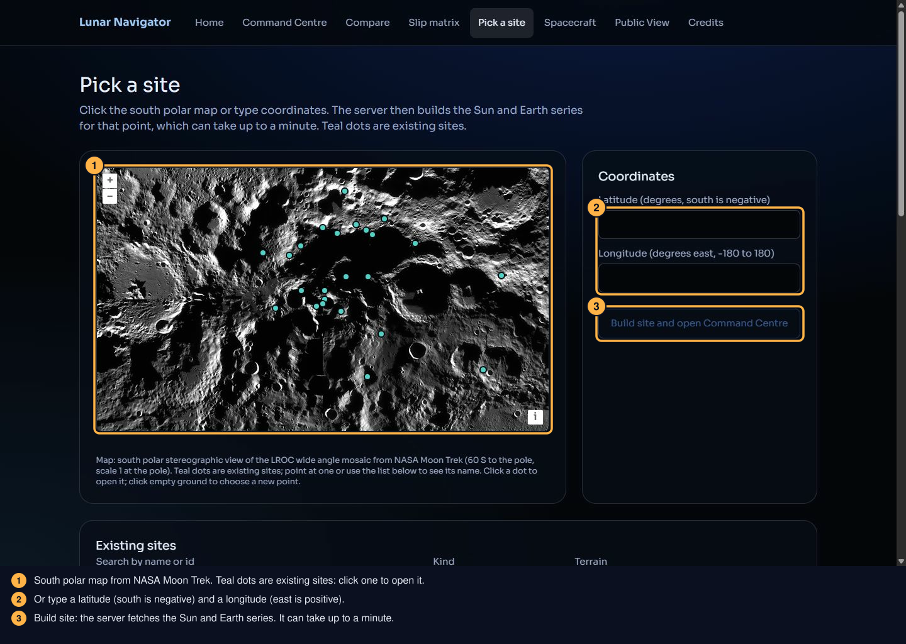

1. The south polar map comes from NASA Moon Trek. Teal dots are existing sites. Click one to open it.
2. Or type a latitude (south is negative, between -89.999 and -60) and a longitude (east is positive).
3. **Build site** asks the server for the Sun and Earth series. It takes up to a minute and shows progress. A new point only gets terrain where height data covers it, and the page says so.

---

## Other pages

| Page | What it is for |
|---|---|
| Compare (`/compare`) | Two to four sites side by side |
| Slip matrix (`/slip`) | How the result changes if the landing date slips by a few days |
| Spacecraft (`/spacecraft`) | Compare dark spells and outages with lander numbers you enter (the defaults are made-up placeholders) |
| Public View (`/public`) | A short story for non-experts, with a glossary |
| Credits (`/credits`) | Every data source, its credit line and whether its terms are confirmed |

## Reading the result honestly

* **Upper bound.** Terrain reaches 300 km in only 46% to 95% of directions across the ten curated sites, so every verdict is an upper bound.
* **Line of sight only.** Earth link means Earth is above the horizon. Antennas, radio power and ground stations are not modelled.
* **Placeholders.** Viability thresholds and the lander values are not mission requirements.
* **Derived points.** The curated sites are tile centres of NASA elevation products, not official landing sites.

More detail: [docs/USER_GUIDE.md](USER_GUIDE.md) (every control and term), [docs/ARCHITECTURE.md](ARCHITECTURE.md) (how the numbers are calculated).
